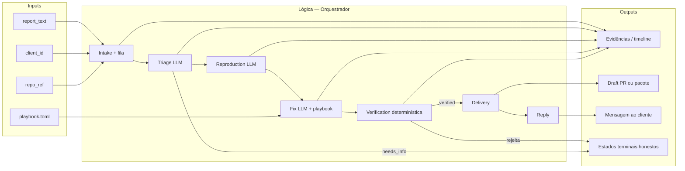

# Documentação do fluxo do agente — ResolveQA

Material de apoio à banca (Edital §8 — **inputs, lógica, outputs**).  
Não recebe nota própria: consulta no Q&A. O que pontua é a clareza na **demo/pitch**.

---

## Problema

Relato do cliente → suporte → dev → QA → resposta: cada passagem perde contexto.  
O ResolveQA coloca **agentes de IA** nesse núcleo, de ponta a ponta, com mínimo de intervenção humana até o draft PR (merge continua humano).

## Diagrama (inputs → lógica → outputs)

**Regra de ouro:** o LLM **não** escolhe o estado final. O orquestrador + verifier decidem com exit codes e políticas.

---

## Inputs

| Entrada | Origem | Papel |
|---|---|---|
| `report_text` | form / API / chat simulado | Relato em linguagem natural (dado não confiável) |
| `client_id` | idem | Isolamento lógico do cliente |
| `repo_ref` | idem | Repositório-alvo (ex. `targets/resolveqa-checkout`) |
| `channel` | sistema | `form` \| `api` \| `simulated_chat` |
| Playbook | `.resolveqa/playbook.toml` | Paths, testes protegidos, limites, tom de reply |
| Snapshot / SSE | Quadro Mola | Operador vê progresso **real** do worker |

## Lógica (etapas)

| # | Etapa | Quem executa | Entrega interna | Falha honesta |
|---|---|---|---|---|
| 1 | Intake | API | Caso `created` + enqueue (`202`) | 400 se contrato inválido |
| 2 | Triage | LLM | Esperado / observado / suspeitos | `needs_info` |
| 3 | Reproduction | LLM + sandbox | Teste **RED** no defeito | `blocked` / `infra_error` |
| 4 | Fix | LLM + playbook gate | Patch mínimo | path fora da política → rejeição |
| 5 | Verification | **Código** (sem LLM) | RED→GREEN + suíte | sem `verified` falso |
| 6 | Delivery | Código | Draft PR ou pacote local | — |
| 7 | Reply | Código | Mensagem ao cliente | só após `verified` |

Modos: `dogfood` (fix determinístico) · `general` (LLM + playbook; **staging atual**).

Limites: tentativas de fix, teto de chamadas LLM, timeout de teste → `blocked` / `infra_error` com motivo.

## Outputs

| Saída | Destinatário | Quando |
|---|---|---|
| Timeline / snapshot / SSE | Operador (Quadro) | Contínuo |
| Logs, diffs, exit codes | Engenharia / auditoria | Por etapa |
| Draft PR ou “PR não publicado” | Revisor humano | Pós-verificação |
| Resposta no canal | Cliente | Somente `verified` |
| `needs_info` / `blocked` / `infra_error` | Suporte | Sem fingir progresso |

Estados: `created` → `triaging` → `triaged` → `reproducing` → `reproduced` → `fixing` → `fixed` → `verifying` → `verified` (ou terminais).

---

## Mapeamento §9.4 (Solução e Uso de IA)

| Parâmetro | Como o ResolveQA evidencia |
|---|---|
| **1. Centralidade da IA** | Sem triage/repro/fix agenticos, não há valor principal |
| **2. Profundidade de engenharia** | Orquestrador, playbook gates, verifier, limites, estados terminais |
| **3. Ativo próprio / defensibilidade** | Playbooks por cliente/repo + cadeia de evidências por `case_id` |

## Ligação ao curso AVA (§10 do edital)

| Módulo AVA | Onde aparece no ResolveQA |
|---|---|
| Prompting / LLMs | Triage, reproduction, fix |
| Ferramentas / function calling | Sandbox de testes, gates de path |
| Orquestração | Máquina de estados multi-etapa |
| Avaliação e segurança | Verifier determinístico + playbook + dados não confiáveis |
| Observabilidade | Timeline, snapshot, SSE no Quadro |

---

## Demo

- Backend: https://d3nqg1nmn3omeh.cloudfront.net  
- Quadro: https://dsh3ja1i4695p.cloudfront.net/quadro  
- Guia passo a passo: [`demo-ao-vivo.md`](demo-ao-vivo.md)

RFC/PRD: [`../rfc/0001-arquitetura-e-contratos.md`](../rfc/0001-arquitetura-e-contratos.md) · [`../cloud-agents.md`](../cloud-agents.md) · [`../PRD.md`](../PRD.md)
