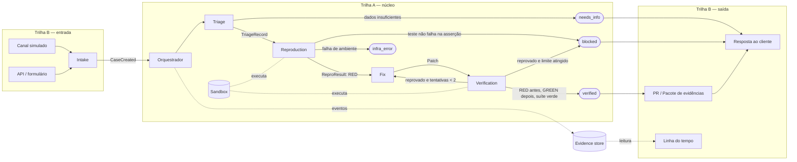

# RFC-0001 — Arquitetura e contratos do ResolveQA

> **Status:** rascunho, versão base, aguardando revisão da equipe.
> **Base:** `docs/PRD.md` (versão base, PR #1).
> **Escopo:** MVP da demo (RF-01 a RF-10) e preparação de modelo de dados para RF-11 e RF-12.
> Nada neste documento foi implementado ou testado. As decisões em aberto da seção 9 não são decididas aqui.

## 1. Contexto

O PRD define o fluxo: o cliente relata um problema, o ResolveQA gera um teste que reproduz o defeito, propõe uma correção mínima, um verificador independente confirma e o cliente recebe uma resposta. Esta RFC fixa:

- os componentes e o fluxo entre eles;
- os contratos de dados (RunState, eventos, evidência) e as interfaces de cada etapa;
- os estados terminais, os limites e as regras de segurança;
- as opções para as decisões pendentes do PRD;
- a divisão do trabalho em duas trilhas, sem arquivos compartilhados entre elas.

**Princípios** (derivados do PRD):

1. O estado do caso é definido por código determinístico, nunca pelo LLM (RF-06).
2. Toda transição gera um evento imutável com evidência (RNF-04, RF-10).
3. Conteúdo do relato, do repositório e de ferramentas é dado, não instrução (RNF-02).
4. Nenhum merge ou deploy automático (RNF-05).
5. O que for simulado aparece rotulado como simulado (RNF-07).

## 2. Arquitetura

### 2.1 Componentes

| Componente | Responsabilidade | RF/RNF | Trilha |
|---|---|---|---|
| **Intake** | Recebe o relato por API ou formulário e cria o caso | RF-01 | B |
| **Canal simulado** | Interface de conversa estilo WhatsApp, rotulada "Canal simulado" | RF-02 | B |
| **Orquestrador** | Máquina de estados; chama as etapas, aplica limites e grava eventos | RF-07, RNF-03, RNF-04 | A |
| **Triage** | Converte o relato em registro estruturado ou pede informação | RF-03 | A |
| **Reproduction** | Gera um teste novo a partir do relato e confirma que falha | RF-04 | A |
| **Fix** | Propõe patch mínimo numa cópia isolada | RF-05 | A |
| **Verification** | Verifier independente: roda teste antes/depois e suíte relevante | RF-06 | A |
| **Sandbox** | Executa código do repositório-alvo isolado, sem segredos | RNF-01 | A |
| **LLM adapter** | Interface única para o provedor de LLM, com mock determinístico | RNF-03 | A |
| **Evidence store** | Guarda eventos e artefatos por caso | RNF-04 | A |
| **PR/Pacote de evidências** | Gera draft PR ou pacote local "PR não publicado" | RF-08 | B |
| **Resposta ao cliente** | Mensagem ao cliente no mesmo canal, só após `verified` | RF-09 | B |
| **Linha do tempo** | Mostra a sequência real de estados, com horário e evidências | RF-10 | B |

### 2.2 Fluxo



O Fix nunca roda testes para decidir estado; quem decide é o Verification, a partir de exit codes e resultados registrados.

## 3. Contratos

Os contratos ficam num único módulo, `contracts`, criado primeiro (issue de contratos, P0). Depois de congelado, só muda por PR revisado pelas duas trilhas. A notação abaixo é neutra; a implementação segue a stack escolhida (seção 9, D5).

### 3.1 RunState

```text
CaseState = created | triaging | triaged | reproducing | reproduced
          | fixing | fixed | verifying
          | verified | needs_info | blocked | infra_error      # terminais (seção 4)

RunState {
  case_id: string             # único, gerado no Intake (RF-01)
  client_id: string           # obrigatório desde o MVP (RF-11)
  repo_ref: string            # identificador do repositório-alvo autorizado
  channel: "api" | "form" | "simulated_chat"
  report_text: string         # relato original, tratado como dado (RNF-02)
  state: CaseState
  terminal_reason: string?    # obrigatório quando o estado é terminal != verified
  attempts: { fix: int, llm_calls: int }   # contadores para RNF-03
  base_revision: string?      # SHA ou hash do repositório antes da correção
  fix_revision: string?       # SHA ou hash depois da correção
  evidence_ids: string[]
  created_at, updated_at: timestamp (UTC, ISO 8601)
}
```

### 3.2 Eventos

Trilha de eventos append-only por caso (RNF-04). Nenhum evento é editado ou apagado.

```text
Event {
  event_id: string
  case_id: string
  seq: int                    # crescente por caso, sem lacunas
  ts: timestamp (UTC)
  source: "intake" | "orchestrator" | "triage" | "reproduction" | "fix"
        | "verification" | "delivery" | "reply"
  type: CaseCreated | StateChanged | EvidenceAdded | LimitReached
      | MessageSent | ReplayStarted
  from_state: CaseState?
  to_state: CaseState?
  reason: string?
  evidence_refs: string[]
  replay_of: { case_id, original_ts }?   # obrigatório em replay (RF-10, RNF-07)
}
```

Regra: `RunState.state` é sempre derivável da sequência de `StateChanged`. A Linha do tempo lê só eventos; não há progresso simulado.

### 3.3 Interfaces de cada etapa

Todas recebem dados imutáveis e devolvem um resultado; nenhuma etapa muda o estado por conta própria. O Orquestrador decide a transição.

```text
Intake.create(report: ReportInput) -> RunState                    # RF-01, RF-02
  ReportInput { client_id, repo_ref, channel, report_text }

Triage.run(case: RunState) -> TriageRecord | NeedsInfo           # RF-03
  TriageRecord { input, expected, observed, suspect_files[], confidence: 0..1 }
  NeedsInfo    { missing_fields[], question_to_support }

Reproduction.run(case, triage: TriageRecord) -> ReproResult       # RF-04
  ReproResult { test_path, test_source_ref, exit_code,
                outcome: "red_on_assertion" | "green" | "env_error",
                failing_assertion?, log_ref }

Fix.run(case, triage, repro: ReproResult) -> Patch                # RF-05
  Patch { diff_ref, files_changed[], touches_tests: bool, touches_ci: bool }

Verification.run(case, repro, patch) -> Verdict                   # RF-06
  Verdict { before: TestRun, after: TestRun, suite: TestRun,
            base_revision, fix_revision,
            result: "verified" | "rejected" | "env_error", reasons[] }
  TestRun { command, exit_code, duration_s, log_ref }

Delivery.build(case, verdict) -> DeliveryResult                   # RF-08
  DeliveryResult { kind: "draft_pr" | "local_package", url_or_path,
                   label: "PR não publicado"?, evidence_refs[] }

Reply.compose(case, outcome) -> CustomerMessage                   # RF-09
  CustomerMessage { channel, text, sent_after_event_seq }

Sandbox.exec(workdir_ref, command, timeout_s) -> ExecResult        # RNF-01
  ExecResult { exit_code, stdout_ref, stderr_ref, timed_out: bool }

LLM.complete(purpose, messages, schema?) -> LLMResult              # RNF-03
  LLMResult { content, tokens_in, tokens_out, provider, model, mock: bool }
```

Regras de contrato:

- `Verification` rejeita qualquer `Patch` com `touches_tests` ou `touches_ci` verdadeiro, ou acima do limite de arquivos (RF-05).
- `Verdict.result = verified` exige `before.exit_code != 0` na asserção ligada ao relato, `after.exit_code == 0` e `suite.exit_code == 0`, com as duas revisões registradas.
- `Reply` só envia mensagem de sucesso se existir evento `StateChanged(to_state=verified)` com `seq` menor que `sent_after_event_seq`.

### 3.4 Formato de evidência

```text
Evidence {
  evidence_id: string
  case_id: string
  kind: report | triage_record | test_source | test_log | exit_code
      | diff | verdict | pr_package | customer_message
  path: string                # relativo a runs/<case_id>/
  sha256: string
  revision: string?           # SHA/hash do repositório-alvo associado
  created_at: timestamp (UTC)
  simulated: bool             # true para canal simulado, PR local e replay
}
```

Layout em disco no MVP: `runs/<case_id>/events.jsonl` (append-only) e `runs/<case_id>/evidence/<evidence_id>.<ext>`. O diretório `runs/` não é versionado.

## 4. Estados terminais

| Estado | Quando | Motivo obrigatório | Mensagem ao cliente (RF-09) | Patch |
|---|---|---|---|---|
| `verified` | Verdict aprovado (seção 3.3) | não | Sucesso, citando o comportamento corrigido | sim, via Delivery |
| `needs_info` | Triage sem dados suficientes | sim, com pergunta ao suporte | Andamento honesto: "precisamos de mais informações" | não |
| `blocked` | Teste não reproduz na asserção, Verdict rejeitado após o limite, patch fora das regras ou limite RNF-03 atingido | sim (`limit_exceeded`, `not_reproduced`, `patch_rejected`) | Andamento honesto | não publicado |
| `infra_error` | Falha de ambiente (instalação, timeout de infraestrutura, sandbox indisponível) | sim | Nenhuma mensagem de bug; registro interno | não |

`infra_error` nunca é apresentado como bug reproduzido (RF-07).

## 5. Limites (RNF-03)

| Limite | Valor proposto | Onde é aplicado | Ao atingir |
|---|---|---|---|
| Tentativas de correção | 2 por caso | Orquestrador (`attempts.fix`) | `blocked`, motivo `limit_exceeded` |
| Chamadas de LLM | 12 por caso | LLM adapter (`attempts.llm_calls`) | `blocked`, motivo `limit_exceeded` |
| Tempo por execução de teste | 10 min | Sandbox (`timeout_s`) | `infra_error` se timeout de ambiente; `blocked` se o teste trava no código-alvo |
| Arquivos alterados pelo patch | configurável; proposta: 3 | Verification | `blocked`, motivo `patch_rejected` |

Os valores são limites propostos, não custos medidos. Ficam em configuração, não no código das etapas.

## 6. Segurança

### 6.1 Segredos (RNF-01)

- O Sandbox executa o código do repositório-alvo numa cópia temporária, com ambiente limpo: sem variáveis de token de Git nem chaves de LLM.
- Chamadas ao LLM e ao Git acontecem só no processo do Orquestrador/Delivery, nunca dentro do Sandbox.
- Logs, prompts, evidências e PRs passam por uma varredura de segredos antes de serem gravados ou publicados. A demo só vale com varredura sem achados.

### 6.2 Conteúdo não confiável (RNF-02)

- Relato, README, logs e saídas de ferramentas entram nos prompts delimitados como dados.
- As ações possíveis são fixas no código (lista de ferramentas permitidas). Nenhuma saída do LLM é executada como comando de shell.
- O Fix só pode escrever dentro da cópia isolada; o Verification confere o diff contra as regras da seção 3.3.
- Teste obrigatório: um relato com instrução maliciosa (por exemplo, pedir para apagar arquivos ou revelar variáveis) não executa a ação pedida.

## 7. Dados

Só dados sintéticos na demo, sem dados pessoais reais (RNF-06). `client_id` existe desde o MVP; a demo usa um único cliente (RF-11 no roadmap).

## 8. Divisão do trabalho em duas trilhas

Objetivo: dois agentes de implementação trabalham em paralelo sem editar os mesmos arquivos. Os caminhos assumem a stack recomendada em D5 (Python); se a equipe escolher outra, mantém-se a mesma divisão por diretório.

| Caminho | Dono | Observação |
|---|---|---|
| `src/resolveqa/contracts/` | **Trilha A** cria; depois congela | Mudança só por PR com revisão das duas trilhas |
| `src/resolveqa/orchestrator/`, `triage/`, `reproduction/`, `fix/`, `verification/`, `sandbox/`, `llm/`, `store/` | Trilha A | Núcleo do pipeline |
| `demo-target/` | Trilha A | Repositório-alvo controlado com o defeito do cupom (D4) |
| `tests/core/` | Trilha A | Testes unitários do núcleo |
| `src/resolveqa/intake/`, `channel/`, `delivery/`, `reply/`, `timeline/`, `web/` | Trilha B | Entrada, saída e interface |
| `tests/edge/`, `tests/e2e/`, `tests/security/` | Trilha B | Testes de borda, ponta a ponta e segurança (caixa-preta) |
| `config/limits.*` | Trilha A | Valores de RNF-03 |
| `README.md`, `docs/` | Revisão por PR | Nenhuma trilha edita sem PR próprio |

Regras:

1. A Trilha B consome o núcleo apenas pelas interfaces de `contracts/` e pela leitura de `runs/<case_id>/events.jsonl`.
2. Enquanto o núcleo não existir, a Trilha B usa um orquestrador falso que emite eventos reais no formato da seção 3.2, rotulado como mock.
3. Arquivos de dependências do projeto (por exemplo, `pyproject.toml`) são criados pela Trilha A na issue de estrutura; a Trilha B pede inclusões por PR.
4. Cada PR toca só caminhos da própria trilha. Um PR que precise cruzar a fronteira é dividido.

**Ordem sugerida:** contratos e estrutura (A) → em paralelo: núcleo (A) e Intake/Canal/Linha do tempo com orquestrador falso (B) → integração → Delivery e Reply com dados reais (B) → teste ponta a ponta e caso negativo (B).

## 9. Decisões em aberto (opções e recomendação; não decididas aqui)

**D1 — Defeito da demo (PRD §10.1)**
- (a) Cupom não aplicado: esperado R$ 180,00, observado R$ 200,00.
- (b) Cupom aplicado duas vezes.
- *Recomendação:* (a). A asserção é direta, coincide com o exemplo do relato e com a mensagem do RF-09 ("total agora R$ 180,00").

**D2 — Onde a verificação roda (PRD §10.2)**
- (a) Processo local isolado: cópia temporária, ambiente limpo, timeout.
- (b) Serviço de build na nuvem.
- *Recomendação:* (a) no MVP: menos dependências e sem credenciais de nuvem; (b) fica no roadmap, atrás da mesma interface `Sandbox`.

**D3 — Provedor de LLM (PRD §10.3)**
- (a) Um provedor com acesso e créditos confirmados, atrás do `LLM adapter`.
- (b) Mock determinístico apenas, para testes e replay.
- *Recomendação:* (a) para a demo ao vivo e (b) sempre disponível nos testes e como plano B rotulado. A escolha do provedor depende de acesso confirmado.

**D4 — Repositório-alvo da demo (PRD §10.4)**
- (a) Fixture dentro deste repositório (`demo-target/`), com Delivery gerando pacote local "PR não publicado".
- (b) Repositório separado, autorizado, com draft PR real.
- *Recomendação:* (a) como base garantida; (b) como extensão se houver autorização a tempo, sem mudar contratos.

**D5 — Stack**
- (a) Python 3.11+, pytest no repositório-alvo, API HTTP leve e interface web simples.
- (b) Node.js/TypeScript com Jest.
- *Recomendação:* (a), por alinhar o executor de testes do alvo com o próprio projeto e reduzir ferramentas.

**D6 — Escopo do RF-11 no MVP (PRD §10.5)**
- (a) Só o campo `client_id`.
- (b) `client_id` e uma segunda demo de cliente.
- *Recomendação:* (a); o isolamento real fica na issue de roadmap.

## 10. Fora de escopo

Igual ao PRD §7: API real do WhatsApp, integrações com helpdesks, isolamento real entre clientes, ambiente parecido com produção, telemetria completa, autenticação e deploy público.

## 11. Impacto de mudanças

- Mudança em `contracts/` afeta as duas trilhas: exige PR próprio, revisão das duas trilhas e atualização desta RFC.
- Escolha de D5 diferente da recomendação muda só extensões e ferramentas; a divisão por diretório da seção 8 se mantém.
- Escolha de D2 (b) ou D4 (b) altera apenas as implementações de `Sandbox` e `Delivery`.
