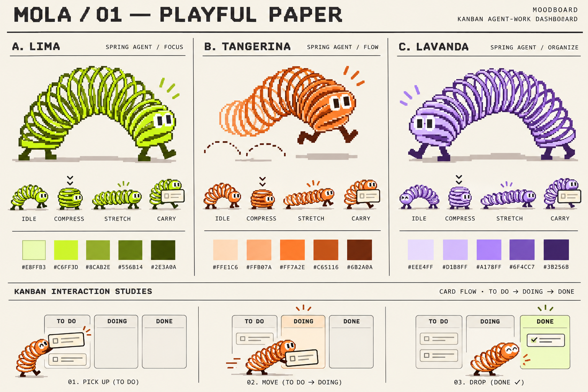
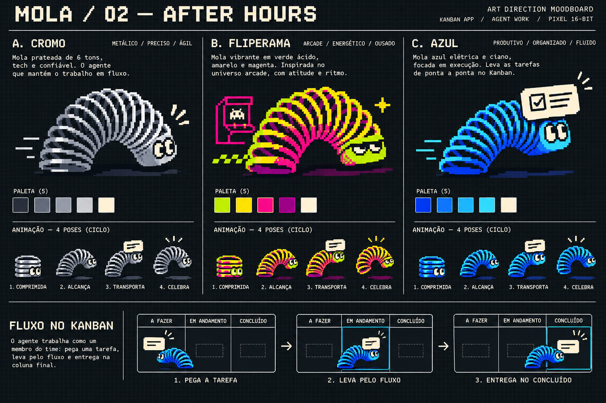

# ResolveQA · Mola e Admin

Repositório público do frontend: https://github.com/ThiagoVenturaV/ResolveQA-front

Backend / cloud: https://github.com/moouraajv/ResolveQA

Workspace para acompanhar a resolução de bugs por agentes: relato, reprodução, correção e verificação independente, com evidências, referências de documentação e playbooks por empresa.

- `/`: landing baseada na primeira referência aprovada, com acessos diretos aos dois ambientes.
- `/quadro`: Kanban operacional com criação, busca, filtros, detalhes, lista e transporte pela Mola original.
- `/admin`: painel preto com execuções, métricas derivadas dos casos, logs exportáveis, traces, agentes, documentação, CRUD de playbooks e configuração da conexão.

**Demo** usa dados sintéticos e armazenamento local. **Produção** consulta a API configurada e recebe SSE opcional; não usa dados de exemplo como fallback. Veja [como conectar e o que falta no backend](docs/production-connection.md).

## Rodar

Requer Node.js 22.13+ e npm. Na primeira instalação, copie .env.example para .env.local. O ambiente é escolhido exclusivamente por RESOLVEQA_MODE; não há seletor nem formulário de conexão na interface.

```sh
npm ci
npm run dev
```

Abra http://localhost:5173. Para gerar a versão de produção:

```sh
npm run build
npm run start
```

## O que explorar

- Cadastro, edição, ativação/pausa e exclusão de playbooks em demonstração, com persistência no navegador.
- Eventos de agentes criando casos e acionando o transporte dos cards. A fila de animação não define o estado de domínio.
- Coluna **Atenção** para `needs_info`, `blocked` e `infra_error`; apenas `verified` entra em **Concluído**.
- Ambiente definido somente no .env, com consulta periódica e recebimento automático das atividades.
- Fontes Montserrat e Manrope hospedadas localmente, com licenças em `public/fonts`.

- Uma mola arco-íris, com seis opções de matiz da mesma arte.
- Avanço manual, reprodução automática pausável e arrastar/soltar cards.
- Criação de tarefas, filtro por agente, detalhes e registro de eventos.
- Estado de demonstração salvo no navegador e exportação JSON dos logs filtrados.
- Layout responsivo, navegação por teclado e redução de movimento conforme a preferência do sistema.
- Pranchas e estudos anteriores preservados no repositório como histórico de arte.

O exemplo .env.example habilita **demo** explicitamente; sem RESOLVEQA_MODE, o padrão é **production**. Reinicie o servidor ou gere um novo build após mudar a configuração. Os casos, spans e documentos iniciais são ilustrativos. Em produção, o front depende de uma API real configurada e protegida pelo gateway da empresa. A criação/consulta de casos segue o backend `moouraajv/ResolveQA`; snapshot, SSE, spans e playbooks são extensões documentadas, ainda não encontradas nas branches auditadas. Não há merge, deploy, execução de agentes ou edição de documentação pelo navegador.

## Validação

```sh
npm test
npx tsc --noEmit
npm run lint
npm run build
```

Com o servidor dev rodando e Chrome instalado:

```sh
npm run test:browser
npm run test:stream
```

`CHROME_PATH` seleciona um executável alternativo; `RESOLVEQA_BASE_URL` troca o endereço do front. O teste de stream abre uma API HTTP/SSE controlada e um front separado com variáveis de produção, sem trocar o ambiente pela interface. As verificações de produção usam serviços locais de teste e não representam ativação de um backend remoto.

## Direção visual

A interface usa a primeira referência aprovada: entrada clara com Mola e Admin em equilíbrio. O painel administrativo usa preto e cinzas neutros, conforme a correção do usuário. Tokens e componentes em [DESIGN.md](DESIGN.md).

Os estudos abaixo são históricos da identidade e do movimento da Mola, preservados junto com o atlas e as novas poses da main.

| Prancha | Explorações |
| --- | --- |
| [Playful Paper](public/moodboards/mola-paper.png) | Lima, Tangerina, Lavanda |
| [After Hours](public/moodboards/mola-night.png) | Cromo, Fliperama, Azul |




O personagem usa um atlas gerado por estado, baseado no desenho da primeira prancha. O transporte adapta a interação da segunda prancha. Veja [arte, movimento e evidências](docs/rainbow-mascot.md).

## Fonte

- `app/page.tsx`: landing e acessos aos ambientes.
- `app/quadro/page.tsx`: Kanban e transporte por fila.
- `app/admin/page.tsx`: painel administrativo e editor de playbooks.
- `components/workspace/`: provider compartilhado, shell, formulários e visualizações.
- `lib/resolveqa/`: contratos validados, adaptador HTTP/SSE e dados de demonstração.
- `app/globals.css`: composição, responsividade e movimento.
- `components/mola/`: atlas, física, palco interativo e transporte.
- `public/moodboards/`: pranchas PNG em resolução original.
- [Contrato de snapshot histórico](docs/snapshots.md): referência anterior; o contrato atual de produção está em docs/production-connection.md.
- [Direção visual](docs/art-direction.md): decisões e contexto.

Implementado com React, TypeScript e Vinext/Vite. O starter inclui a configuração de publicação privada pelo Sites; não há credenciais de GitHub no cliente.
